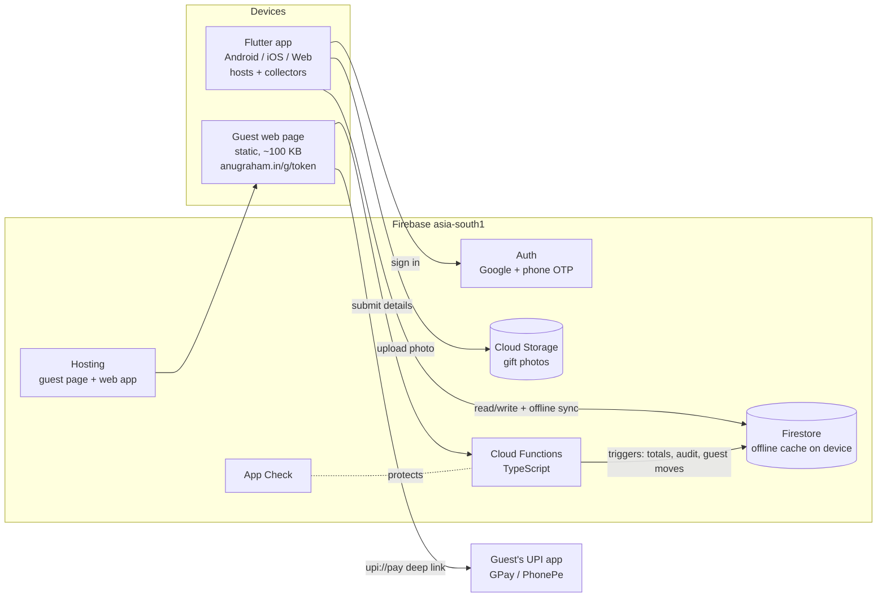

# Anugraham – Architecture Spec (v1)

Nov 8, 2026 · @Barani

## 1. Summary and principles

**What we're building:** Anugraham — a moi (gift) register for Indian families. One Flutter codebase (Android, iOS, web) for hosts and collectors, a tiny separate web page for guests, and Firebase in Mumbai as the backend. Companion docs: *Moi App – Master Plan*, *Moi App – MVP PRD (v1)*, *Anugraham Design System*, *Anugraham – MVP Mockups*.

**Principles (in priority order)**

1. **Never lose an entry.** Every write works offline and syncs later; nothing is ever hard-deleted by a client.
2. **Never touch money.** UPI goes guest → host directly; we only store what people tell us.
3. **Trust inside the family.** Every change is attributable (who, when, before/after), written server-side so clients can't fake it.
4. **Minimum personal data** (DPDP): optional phone numbers, private photos, export and delete always available.
5. **Tamil first, every Indian language ready.** No hard-coded strings; layouts survive long text.
6. **Boring, cheap, solo-operable.** Managed services, scale-to-zero, no servers to patch. Cost stays near zero until real usage.

**Non-goals for v1:** payments, voice entry, notebook OCR (parked — see PRD E10), B2B billing, languages beyond Tamil + English.

## 2. System overview



### Components

| Component | Technology | Responsibility |
| --- | --- | --- |
| **Host app** | Flutter (stable, Dart 3.9+), BLoC, go\_router, flutter gen-l10n | All host and collector screens; works offline; generates the PDF register on-device |
| **Guest page** | Static HTML + a few KB of JS (Astro or plain), Firebase Hosting | Show event, open UPI app, submit name/amount/wishes. No login, no framework, loads fast on 4G |
| **Auth** | Firebase Auth: Google sign-in + phone OTP | One login per person; family sharing via roles, never shared passwords |
| **Database** | Cloud Firestore, location **asia-south1** (permanent) | Families, events, members, entries, contacts, audit log |
| **Files** | Cloud Storage (same region) | Gift photos (compressed ≤ 300 KB), later notebook pages |
| **Server logic** | Cloud Functions 2nd gen, TypeScript | Guest submissions, invites, totals, audit log, data export/delete, scheduled backups |
| **Abuse protection** | App Check (Play Integrity / App Attest / reCAPTCHA on web) + per-IP rate limit in functions | Guest page spam, scripted writes |
| **Observability** | Crashlytics, Analytics (after consent), Cloud Logging, budget alerts | Crashes, funnels, cost |

**Why no own backend server (Spring Boot) in v1:** Firestore gives offline sync, real-time updates between 4 collectors and security rules for free. A Spring Boot API would need its own sync engine. Revisit when B2B reporting or relational queries outgrow Firestore (ADR-2).

## 3. Key flows

### 3.1 Hall entry (offline-first)

1. Collector opens the event; the app already has it cached.
2. Save → the app creates `events/{e}/entries/{ulid}` with `source: hall`, `status: confirmed`, `createdBy`, `deviceTime`. Firestore writes to the local cache instantly.
3. UI shows the entry at once; while `hasPendingWrites` is true the row shows *"Saved on phone"* (cloud-off icon).
4. When network returns, the SDK syncs. A function trigger (`onEntryWritten`) updates `events/{e}.stats` (totals by mode, counts) with `FieldValue.increment` and writes the audit record.
5. Other collectors see the entry in real time.

*Why ULIDs:* created on the device, sortable by time, never collide across 4 offline phones.

### 3.2 Guest submission

1. Host shares `anugraham.in/g/{token}` or its QR — `token` is a random 12+ character id stored on the event, **not** the event's document id.
2. Guest page calls `getGuestEvent(token)` (function) → returns only public fields: host names, date, receivers' labels and UPI IDs.
3. Guest fills side, name, ooru, amount, wishes and taps **Pay** → `submitGuestEntry` (App Check, per-IP rate limit) creates the entry **first** (`source: guest`, `status: confirmed` if the event's `autoAcceptGuests` is on, else `pending`; `guestRef` like `AN-K7Q2`) and returns the ref.
4. The page then opens `upi://pay?pa=<vpa>&pn=<name>&am=<amount>&tn=<guestRef + name>&cu=INR`. Money never passes through us.
5. On return (page visibility change) the page shows *Thank you* + ref; it stores the ref in `localStorage` so reopening the link shows the same state. *Try again* re-opens the same UPI intent (no new entry).
6. Host side: guest entries carry a "guest-reported" tag; with auto-accept off they sit in *Pending* until confirmed/rejected (audit-logged). *Add from UPI history* creates an entry for payments with no form.

### 3.3 Invite a family member / collector

1. Owner taps *Share with family* → function `createInvite(eventId|familyId, role)` creates `invites/{code}` (expires in 7 days, single use).
2. Link opens the app (or web) → person signs in with their own account → `acceptInvite(code)` writes `members/{uid}` with the role.
3. Roles: **owner** (everything), **collector** (add entries, edit own entries for 24 h), **viewer** (read only).

### 3.4 UPI receiver check (₹1 test)

We cannot verify a UPI ID ourselves (no payment licence, no PSP). So:

1. Host enters the UPI ID → format check (`name@handle`).
2. *Send ₹1 test* opens the host's own UPI app with that ID → the UPI app shows the **registered account name**.
3. Back in Anugraham, the *UPI name check* sheet asks: *"Did your UPI app show this name?"* → host confirms the name → we store `verifiedAt` and the confirmed `displayName`.
4. Unverified receivers show an amber badge to the host (never to guests).

### 3.5 PDF register

Generated **on the device** with the `pdf` + `printing` packages and embedded Noto Sans Tamil — works offline, costs nothing, no data leaves the phone. Excel/CSV export the same way.

### 3.6 Delete my data / export my data

Callable functions: `exportMyData` (zip of JSON + CSV to a signed URL, 24 h expiry) and `deleteMyAccount` (removes memberships, the user's own families with all children, photos; anonymises their `createdBy` in other families' audit logs). Required for DPDP.

## 4. Data model, offline sync, security

### 4.1 Firestore collections

| Path | Key fields | Written by |
| --- | --- | --- |
| `users/{uid}` | name, phone?, language, createdAt | the user |
| `families/{f}` | name, ownerUid, defaultUpi? {vpa, displayName, verifiedAt?} | owner |
| `families/{f}/members/{uid}` | role (owner / viewer), addedBy, addedAt | functions (invites) |
| `families/{f}/contacts/{c}` | name, nameTa?, ooru, relation?, phone?, mergedInto? | members |
| `families/{f}/contacts/{c}/history/{eventId}` | eventTitle, date, direction (received / gave), mode, amountRupees?, gift?, weightMg? | **functions only** (derived) |
| `families/{f}/outgoing/{id}` | contactId, eventTitle, date, mode, amountRupees? / gift | members ("moi we gave") |
| `events/{e}` | familyId, type, title, date, venue, hostNames, receivers\[0..2\] {id, label, vpa, displayName, verifiedAt?}, guestToken, autoAcceptGuests (default true), status (open / locked), stats {count, cash, upi, goldMg, silverMg, gifts, pending} | owner (stats: functions) |
| `events/{e}/members/{uid}` | role (owner / collector / viewer) | functions (invites) |
| `events/{e}/entries/{ulid}` | contactId?, giverName, ooru, relation?, mode, amountRupees?, giftDesc?, weightMg?, photoPath?, receiverId?, status (confirmed / pending / rejected / deleted), source (hall / guest / import), utr?, guestRef?, message?, createdBy, deviceTime, serverTime | collectors (hall), functions (guest) |
| `events/{e}/auditLog/{id}` | entryId, action, before, after, by, at | **functions only** |
| `invites/{code}` | scope (family / event), targetId, role, expiresAt, usedBy? | functions only |

**Money and weights are integers:** `amountRupees` (moi is in whole rupees), `weightMg` (4 g = 4000). Never floats.

**Why events are top-level, not under families:** a professional moi writer can collect for an event without joining the family; the guest token maps to one event.

**Reciprocity without expensive queries:** a trigger copies each confirmed entry into `contacts/{c}/history/{eventId}`, so the contact page is one small read and rules stay simple (no collection-group queries).

### 4.2 Offline sync

- Android/iOS: Firestore persistence is on by default; set cache size to unlimited for collectors' events. Web: enable `persistentLocalCache` (IndexedDB, multi-tab).
- **Creates only** from the hall screen; edits are rare updates; deletes are `status: deleted` updates (owner only). No hard deletes from clients.
- Same-entry edit conflicts: last write wins; the audit log keeps both versions, so nothing is silently lost.
- Totals: show `stats` from the server **plus** the local sum of entries with pending writes, so the band never jumps backwards.
- Before locking an event, the app warns if any collector still has unsynced entries (members report `lastSyncedAt`).

### 4.3 Security rules (model)

```
function role(e) { return get(/databases/$(database)/documents/events/$(e)/members/$(request.auth.uid)).data.role; }
function isMember(e) { return request.auth != null && exists(/databases/$(database)/documents/events/$(e)/members/$(request.auth.uid)); }

match /events/{e} {
  allow read: if isMember(e);
  allow update: if role(e) == 'owner' && !request.resource.data.diff(resource.data).affectedKeys().hasAny(['stats','guestToken','familyId']);
  match /entries/{id} {
    allow read: if isMember(e);
    allow create: if role(e) in ['owner','collector']
      && get(/databases/$(database)/documents/events/$(e)).data.status == 'open'
      && request.resource.data.createdBy == request.auth.uid
      && request.resource.data.source == 'hall'
      && request.resource.data.status == 'confirmed'
      && validEntry(request.resource.data);
    allow update: if role(e) == 'owner'
      || (role(e) == 'collector' && resource.data.createdBy == request.auth.uid
          && request.time < resource.data.serverTime + duration.value(24, 'h')
          && request.resource.data.status == resource.data.status);
    allow delete: if false;
  }
  match /auditLog/{id} { allow read: if role(e) == 'owner'; allow write: if false; }
  match /members/{uid} { allow read: if isMember(e); allow write: if false; }
}
```

- `validEntry` checks types, string lengths, `amountRupees` is an int between 1 and 1,00,00,000, mode in the allowed list.
- Storage: `photos/{eventId}/{entryId}.jpg` — read/write only for event members (Storage rules can read Firestore membership); max 1 MB, images only.
- Guest writes never touch Firestore directly; only `submitGuestEntry` (Admin SDK) can create `source: guest` entries.
- **Rules are tested** with the Firestore emulator in CI — every rule above has an allow and a deny test.

## 5. Code structure and decisions

### 5.1 Monorepo

```
anugraham/
├─ CLAUDE.md                 # rules for Claude Code (section 7)
├─ docs/                     # PRD.md, ARCHITECTURE.md, adr/, design-tokens.json
├─ app/                      # Flutter app (android, ios, web)
│  ├─ lib/
│  │  ├─ app/                # bootstrap, router (go_router), theme built from tokens
│  │  ├─ l10n/               # app_ta.arb, app_en.arb (generated code not committed)
│  │  └─ features/<name>/    # view/ (pages, widgets) + bloc/ (cubits/blocs)
│  └─ test/                   # mirrors lib/
├─ packages/
│  ├─ anugraham_ui/           # design system widgets + ThemeExtension from tokens
│  ├─ domain_models/          # Entry, Event, Contact, Money, Weight (pure Dart)
│  ├─ firestore_client/       # data layer: DTOs, converters, queries
│  └─ events_repository/      # repositories the blocs use (also contacts_, auth_)
├─ guest-web/                # static guest page (+ its own tiny i18n)
├─ functions/                # TypeScript Cloud Functions + tests
└─ firebase/                 # firestore.rules, storage.rules, indexes, rules tests
```

Features: `auth`, `onboarding`, `events`, `hall_entry`, `entries`, `guest_review`, `gifts`, `contacts`, `export`, `settings`, later `notebook_import`.

### 5.2 Layers (Very Good layered architecture)

Presentation (widgets) → Business logic (BLoC / Cubit) → Repository → Data (Firestore client). Each layer depends only on the one below. Widgets never touch Firestore; blocs never touch DTOs.

### 5.3 Decisions (ADRs)

| # | Decision | Why | Revisit when |
| --- | --- | --- | --- |
| ADR-1 | Flutter for Android, iOS and web | One codebase, good on low-end Android, strong offline story | Web app performance becomes a problem |
| ADR-2 | Firebase (Firestore + Functions) instead of Spring Boot API | Offline sync, real-time and security rules out of the box; solo-operable | B2B reporting, complex relational queries, or cost at scale |
| ADR-3 | BLoC / Cubit + go\_router | Matches the installed Very Good Flutter plugin's skills and reviewer | — |
| ADR-4 | Integers for money (rupees) and weight (mg) | No float errors in totals | Paise needed |
| ADR-5 | Never process payments; UPI deep links only | No RBI licence; trust | Paid transfers become a product |
| ADR-6 | Separate static guest page | Fast on 4G, no app install | — |
| ADR-7 | PDF/Excel generated on device | Free, offline, private | Very large registers are slow on low-end phones |
| ADR-8 | Client-generated ULIDs for entries | Offline, multi-device, time-sortable | — |
| ADR-9 | Audit log and totals written only by functions | Clients can't fake history or totals | — |
| ADR-10 | Tamil + English launch; all Indian languages via ARB + region packs | Quality over coverage | A region shows demand |

## 6. Environments, delivery, quality, privacy, cost

### 6.1 Environments

|  | dev | prod |
| --- | --- | --- |
| Firebase project | `anugraham-dev` | `anugraham-prod` |
| Flutter flavor | `dev` (app id suffix `.dev`) | `prod` |
| Data | fake data only | real users |
| Who deploys | Claude Code / you | you, manually approved |

Local development runs against the **Firebase Emulator Suite** (Auth, Firestore, Functions, Storage) — no cloud cost, safe to break.

### 6.2 CI/CD (GitHub Actions)

- **On every PR:** `dart format --set-exit-if-changed`, `flutter analyze`, `flutter test`, functions `npm test`, Firestore/Storage rules tests on the emulator.
- **On merge to `main`:** deploy rules, indexes, functions and hosting to **dev**.
- **On a version tag:** build the Android App Bundle (and later iOS via Codemagic), deploy to **prod** after manual approval; upload to the Play closed-testing track.

### 6.3 Testing strategy

| Level | What | Tool |
| --- | --- | --- |
| Unit | money/weight formatting (₹1,00,001), ULIDs, validators, totals | `test` |
| Bloc | every cubit/bloc state transition | `bloc_test` + `mocktail` |
| Widget | each screen in Tamil and English, large text (200%) | `flutter_test`, goldens |
| Rules | every allow and deny path | `@firebase/rules-unit-testing` |
| Functions | guest submit, invites, triggers, export/delete | emulator + `vitest`/`jest` |
| Manual | 4 phones offline in airplane mode → reconnect → totals match | checklist before each release |

### 6.4 Observability

Crashlytics (no personal data in logs), Analytics events only after consent (`event_created`, `entry_saved` with mode only, `guest_link_shared`, `register_exported`), Cloud Logging for functions, uptime check on the guest page, and a **GCP budget alert** (e.g. ₹500/month) on prod.

### 6.5 Privacy and DPDP mapping

| Duty | How |
| --- | --- |
| Notice + consent | First-run consent screen (Tamil/English); guest page notice before submit |
| Purpose limitation | Data used only to show the family's register; no ads, no selling |
| Rights: access / correction / erasure | Edit in app; `exportMyData`; `deleteMyAccount` |
| Contact for questions (Rule 9) | "Help & questions about your data" in Settings + privacy policy |
| Security | Rules tested, App Check, data in India, encryption at rest (Google default), least-privilege service accounts |
| Breach | Runbook: detect → assess → notify Board and affected users within the prescribed time |
| Retention | Deleted accounts purged within 30 days; scheduled backups kept 30 days |

### 6.6 Cost guardrails (estimates)

At MVP scale (hundreds of events) Firebase usage should stay within or near the free quotas; main real costs are store fees and SMS OTP. Guardrails: budget alert, compress photos client-side, paginate entry lists (50 at a time), no listeners on whole collections, scheduled export instead of Firestore point-in-time recovery until usage justifies it.

## 7. CLAUDE.md and the first Claude Code sessions

The `CLAUDE.md` for the repo root is attached in chat as a file (same content as below in summary). It encodes the non-negotiables: never handle money, never lose an entry, functions-only audit/totals, no hard-coded strings (Tamil + English ARB in the same change), integer money/weight, minimum personal data, design tokens only, tests before "done", no prod deploys without approval.

### Before session 1 (you)

- [ ] Create the private GitHub repo `anugraham`; add `CLAUDE.md`, `docs/PRD.md` (export the PRD doc), `docs/ARCHITECTURE.md` (export this doc), `docs/design-tokens.json` (from the design system).
- [ ] Create Firebase `anugraham-dev` with Firestore in **asia-south1**; Blaze plan + budget alert.
- [ ] Install Flutter, Node LTS, Firebase CLI, FlutterFire CLI; enable the firebase, github, code-review and Very Good Flutter plugins in Claude Code.

### Session plan

| # | Session goal | Prompt to start with |
| --- | --- | --- |
| 1 | Scaffold | "Read CLAUDE.md and docs/. Plan, then scaffold the monorepo per ARCHITECTURE §5.1: Flutter app with dev/prod flavors, packages, l10n (ta, en), go\_router, theme from design-tokens.json, firebase emulators config. No features yet. Run analyze and tests." |
| 2 | Rules first | "Implement firestore.rules and storage.rules per §4.3 with full allow/deny tests on the emulator." |
| 3 | Auth + family (E1) | "Implement PRD E1 with tests, Tamil and English." |
| 4 | Events + invites (E2) | "Implement E2 incl. UPI receivers, ₹1 test sheet, createInvite/acceptInvite functions." |
| 5 | **Hall entry (E3)** | "Implement E3 offline-first per §3.1; prove with a test that offline entries sync and totals match." |
| 6+ | E6, E7, E5, E8, E4, E9 | One epic per session, in the PRD build order |

After each session: open a PR, run the code-review plugin, read the diff yourself, merge, and try it on a real low-end Android phone.

## 8. Gap review additions (16 Nov 2026)

**Dev project (verified in the console, 16 Nov 2026):** display name `anugraham-dev`, **project ID `anugraham-dev-83368`** — use the ID in the CLI and FlutterFire. Firestore location `asia-south1`. Plan: Spark (upgrade to Blaze pending). Authentication not yet enabled. No apps registered yet.

### 8.1 Firebase plan: Spark is not enough for this design

- **Verified:** Firebase phone-number sign-in needs a billing account (Blaze); there is no free SMS quota. Google Play requires apps with account creation to offer account deletion in the app and through a web link.
- **To verify in the Firebase console (as far as I know):** Cloud Functions cannot be deployed on Spark, and new Cloud Storage buckets also need Blaze.
- **Impact:** guest submissions, invites, the audit log and totals all run in Cloud Functions. Without them the security model (§4.3, ADR-9) does not hold.
- **Recommendation:** use Blaze. It keeps the same free quotas, so MVP usage should cost close to ₹0; set a budget alert (e.g. ₹500/month) on day one. Develop on the local emulators, which need no plan at all.
- **If you insist on Spark for now:** build sessions 1–3 on emulators only and switch to Blaze before session 4 (invites need functions).

### 8.2 Technical gaps

| Gap | Decision |
| --- | --- |
| Sign-in provider | Google only in MVP (ADR-11). Phone OTP later, with App Check, SMS region policy (India only) and reCAPTCHA SMS defense against SMS-pumping fraud |
| Deep links for invites and "open in app" | Android App Links / iOS Universal Links on our own domain (`anugraham.in/i/{code}`), with web fallback. The domain is therefore needed before session 4 |
| Serial numbers offline | Not stored; derived from `deviceTime` order, frozen into the register at lock (`lockedOrder`) |
| Lock vs late offline entries | Rules allow collectors to create only `status: pending`, `late: true` entries once the event is locked; owner accepts or rejects |
| Double submit on the guest page | Client sends an idempotency key; `submitGuestEntry` returns the existing entry for a repeated key |
| Duplicate detection | Client-side check on name + ooru + amount within the cached event; flag `possibleDuplicateOf` |
| Sign-out / uninstall with unsynced writes | Block sign-out while `hasPendingWrites`; show unsynced count on Home |
| Schema changes later | `schemaVersion` on families and events; migrations run in functions |
| Old app versions | `config/app.minVersion` document → force-update screen |
| Dates and time zones | Event date stored as a local date string (`2027-02-12`); timestamps in UTC; display in the device locale |
| Search | No server full-text search. Search runs on the device over the cached event (fine for a few thousand entries) |
| Two owners | `members.role = owner` may be held by up to 2 people; `transferOwnership` function |
| Guest link reset | `rotateGuestToken` function (owner only); old QR stops working — warn before use |
| Static pages | Privacy policy, Terms, `anugraham.in/delete` (web deletion request) and the landing page on Firebase Hosting |
| Play Store launch requirements | Data safety form, privacy policy URL, account-deletion URL, content rating, target API level, closed test with the required testers for personal accounts |

### 8.3 Security review

| Threat | Mitigation |
| --- | --- |
| Scripted writes / scraping | App Check enforced on Firestore, Storage and Functions; debug tokens only in dev |
| Guessing guest links | 12+ random characters; rate limit on `getGuestEvent`; responses reveal nothing for unknown tokens |
| Fake guest entries inflating totals | Rate limits per IP hash and device; sane amount cap; guest-reported totals shown separately; bulk reject; link reset |
| UPI ID swapped by an insider | Only owners can edit receivers; every change is audit-logged, clears `verifiedAt` and shows a banner to all owners; guest page shows the account display name so guests can compare it in their UPI app |
| Invite link forwarded to a stranger | Single use, 7-day expiry, accept screen shows inviter and role; owner sees and can remove members; removal takes effect immediately through rules |
| Lost or stolen collector phone | Owner removes the member; optional app lock (device biometric) in v1.1 |
| Owner account lost | Second owner; ownership transfer |
| Location leak through photos | Strip EXIF (GPS) and re-encode photos on the device before upload |
| Malicious text in names or wishes | Escape all guest text on render; no HTML; length limits; **prefix cells starting with = + - @ in Excel/CSV export** (formula injection) |
| Guest page tampering / third-party scripts | Strict Content-Security-Policy, no third-party scripts or trackers, HTTPS only |
| Leaked keys | No secrets in the repo; restrict the Android key by package + SHA and the web key by referrer; secrets in Functions config only |
| Function input abuse | Schema validation (zod) on every callable; authenticated callables check membership server-side; least-privilege service accounts |
| Supply chain | Pinned dependencies, Dependabot, license check, code review on every PR |
| Backups exposed | Export bucket private, 30-day lifecycle, restore drill once before launch |
| Children's data | 18+ only in Terms; no child-directed features |

### 8.4 New decisions

| # | Decision | Why |
| --- | --- | --- |
| ADR-11 | Google sign-in only for MVP | Free, no SMS fraud, already on every Android phone |
| ADR-12 | Soft lock: late entries become pending, never rejected | Principle 1 — never lose an entry |
| ADR-13 | Serial numbers derived, frozen at lock | Offline multi-collector entry makes live numbering impossible |
| ADR-14 | Blaze plan with budget alert | Functions, Storage and (later) phone sign-in need it |
